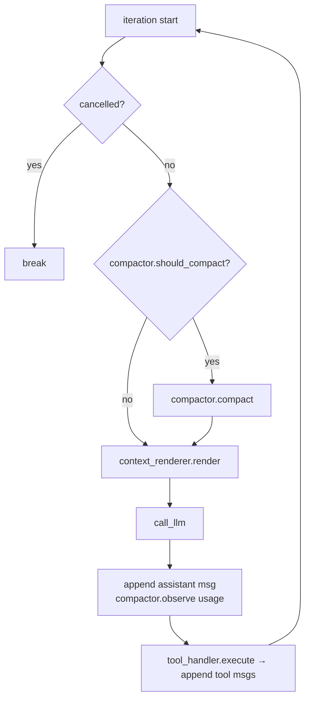

# Context compaction

Long-running agents (server jobs, Organization members) eventually outgrow the model's
context window. Compaction keeps them under it: when the next request nears the limit,
the older part of the history is archived to disk, replaced by a rolling summary, and
the recent tail is kept word for word.

Opt-in per agent:

```python
from agent_harness import Agent, AgentWorkspace, CompactionConfig

agent = Agent(model='anthropic/claude-sonnet-4.5', system=ROLE, compaction=CompactionConfig())
AgentWorkspace('analyst').attach(agent)   # optional: archive lands in the sandbox
```

Code: `context/compaction.py` (policy, summarizer, `Compactor`), `context/archive.py`
(`HistoryArchive`), `context/compaction_prompt.md` (summarizer prompt). Contracts:
`tests/test_compaction.py`.

---

## 1. What happens to the history

```
BEFORE (≥ threshold × window)              AFTER
┌──────────────────────────────┐           ┌──────────────────────────────┐
│ 0  system                    │ ───────── │ 0  system          (cached)  │
│ 1  user: task          (pin) │ ───────── │ 1  user: task      (pinned)  │
│ 2  <compacted_history> (old) │ ┐         │ 2  user: <compacted_history> │ ← new rolling summary
│ 3  assistant + tool_calls    │ │ archived│      summary · plan · archive │
│ …                            │ │ → JSONL │      path                    │
│ k  tool                      │ ┘ segment │                              │
├──────────── cut ─────────────┤           ├──────────────────────────────┤
│ k+1 assistant + tool_calls   │ ───────── │ 3  assistant + tool_calls    │
│ …   recent tail (verbatim)   │ ───────── │ …  recent tail (verbatim)    │
└──────────────────────────────┘           └──────────────────────────────┘
```

| Rule | Why |
|---|---|
| `messages[0]` (system) is never touched | Keeps the cached system anchor |
| The current run's task (`agent.turn_task`) is pinned word for word when the cut swallows it | The goal never drifts through repeated summaries |
| The cut never lands on a `tool` message | Every tool_call/tool_result pair stays on one side; the API rejects orphans |
| The tail is about `keep_recent × window` tokens | The model keeps its working memory |
| The previous `<compacted_history>` falls inside the next archived span | Rolling: summary N+1 is built from summary N plus the new messages |
| Each message is archived once (the pinned task and old summaries repeat) | The tail kept by compaction N is the span archived by N+1 |

The pinned task is `agent.turn_task`, the user message `run()` appended. In a
multi-turn chat or an Organization inbox, that is the current turn's message;
earlier turns' goals carry forward through the summary's *Goal* section.

---

## 2. Where it runs



Iteration start is the only safe point: every tool_call already has its result, so
rewriting history there never breaks a pair (the same rule hooks follow).

---

## 3. Token accounting

The provider's `usage` is exact but describes the previous request. Messages appended
since then are estimated at JSON chars / 4.

```
next request ≈ last.prompt_tokens + last.completion_tokens   ← exact (observe)
             + chars(messages appended since) / 4             ← tool results, nudges, new task
```

`observe` also records the **overhead**: the part of the prompt not visible in
`messages` (tool schemas, dynamic context), as `prompt_tokens − estimate(messages)`.
When usage is missing, and right after a compaction, the estimate is
`overhead + chars/4 of all messages`.

The context window comes from `CompactionConfig(context_window=)`, or is asked of the
provider once on the first check (`client.resolve_context_window`: OpenRouter
`/models` → `context_length`, vLLM `/v1/models` → `max_model_len`). An unlisted model
raises, which tells you to pass `context_window=`.

---

## 4. Config

| Field | Default | Meaning |
|---|---|---|
| `threshold` | `0.80` | Compact once the next request reaches this fraction of the window |
| `keep_recent` | `0.25` | Token budget for the verbatim tail, as a fraction of the window |
| `context_window` | `None` | Max context in tokens; `None` asks the provider |
| `summary_max_tokens` | `4_000` | Output cap for the summarizer call |
| `archive_dir` | `None` | Archive root; `AgentWorkspace.attach` fills it with `sandbox/history` when unset |

`0 < keep_recent < threshold < 1` is enforced at construction.

---

## 5. Summarizer

A one-shot, non-streaming, tool-less call to the agent's own model
(`compaction.summarize`). The archived span goes in as a **text transcript**
(`render_transcript`), not as chat messages. That avoids tool-pairing rules and keeps
the model from continuing the conversation. Each message is headed `[#n role]`, where
`n` is its line in the archive segment, so the summary can cite `(archive #41)`. Tool
results are clipped at 2,000 chars and arguments at 300; the archive keeps them in full.

The prompt (`compaction_prompt.md`) asks for fixed sections: Goal · Completed ·
Decisions & rationale · Current state · Open threads & next steps · Key facts &
numbers · Files & artifacts. It also requires folding in the previous summary without
dropping facts. The call's usage is reported to the sink, so its cost shows in the TUI
and logs.

The block that replaces the span:

```xml
<compacted_history archived_messages="84" archive="history/20261014T153000_ab12cd/segment_002.jsonl">
Earlier messages in this conversation were compacted to save context. The full record is in …
<summary>…</summary>
<plan>…render_plan(agent.plan)…</plan>        (omitted when the plan is empty)
</compacted_history>
```

---

## 6. Archive

```
~/.agent_harness/workspaces/<name>/sandbox/          ← ExecuteCode cwd
  └─ history/
      └─ 20261014T153000_ab12cd/                     ← one folder per Compactor (session)
          ├─ segment_001.jsonl                       ← span removed by compaction 1
          └─ segment_002.jsonl                       ← compaction 2 (opens with the task and summary 1)
```

JSON Lines, one chat message per line, written once per compaction. The session
suffix keeps processes sharing a workspace from overwriting each other. Paths in the
block are relative to the sandbox, so model code opens them directly:

```python
import json
rows = [json.loads(l) for l in open('history/20261014T153000_ab12cd/segment_002.jsonl')]
[r['content'] for r in rows if r['role'] == 'tool' and 'AAPL' in r['content']]
```

Without a workspace or `archive_dir`, compaction still runs; the block says no archive
was kept.

---

## 7. Failure modes

| Situation | Behavior |
|---|---|
| Provider sends no `usage` | `overhead + chars/4` estimate for that check |
| Context window unknown | `RuntimeError` on the first check; pass `context_window=` |
| Summary call fails (`openai.APIError`) | Archive still written; the block says the summary is unavailable; `CompactionEvent.summarized=False`; WARNING log. Not `on_error`, because the run continues |
| Last tool result bigger than the tail budget | Archived together with its call (empty tail); the summary sees a clipped copy |
| Pinned task or overhead alone over threshold | `ContextOverflowError` (fail fast instead of compacting every iteration) |
| Prompt cache | Invalidated once per compaction; the system anchor survives |
| `SubAgent(compaction=…)` | `NotImplementedError`: subagent runs are short and isolated |

---

## 8. Observability

`Sink.on_compaction(CompactionEvent)` fires after each compaction with
`tokens_before`, `tokens_after` (estimates), `archived_messages`, `segment`, and
`summarized`.

| Sink | Output |
|---|---|
| `StdoutSink` | `[compaction] ~9,000 -> ~2,500 tokens, 40 messages archived (summarized)` |
| `LogSink` | INFO line; WARNING when the summary failed |
| `LangfuseSink` | `compaction` event under the current iteration (WARNING level on failure); the summary call itself is an auto-captured generation |

---

## 9. Not built (yet)

| Idea | Why deferred |
|---|---|
| Clearing old tool outputs before a full summary (cheaper first step) | Wait for Langfuse traces to show tool output dominating |
| Separate cheaper `summary_model` | YAGNI; one config field when needed |
| Archiving the final live tail at process exit | Nothing reads it after the process ends |
